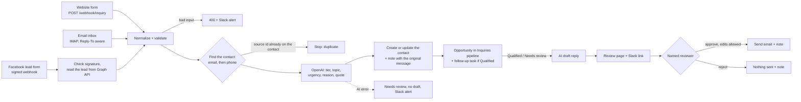

# AI Lead Intake for GoHighLevel (n8n + OpenAI + Facebook lead forms)

An n8n setup for teams that still copy inquiries into GoHighLevel by hand. Inquiries come in from a website form, an email inbox and a Facebook lead form. Each one is matched to an existing contact or added as a new one, and OpenAI sorts it as Qualified, Needs review or Not qualified. Qualified leads get an opportunity in the pipeline and a follow-up task. For leads worth answering the AI also drafts a reply, and a person has to approve it before it goes out.

This is the GoHighLevel version of [AI Lead Intake for HubSpot](https://github.com/rikkadawufa/ai-lead-intake-hubspot) and [for Salesforce](https://github.com/rikkadawufa/ai-lead-intake-salesforce). It uses the same test inquiries, prompts, OpenAI model and review page, and all three pass the same eight test scenarios. This version adds Facebook lead forms as a third source, and someone who writes in through the form, by email and through Facebook still ends up as one contact.

The business is fictional: Tidewell Commercial Cleaning, an office cleaning company. All test inquiries are made up and use the reserved `example.com` / `example.org` domains and 555-01xx phone numbers.

## What it does

### Intake

`wfFormIntake` takes a JSON POST from a website form. `wfEmailIntake` watches the inbox over IMAP and takes the sender from `Reply-To` when there is one, since many contact forms send notification emails that way. `wfMetaLeadIntake` receives Meta's `leadgen` webhook, rejects any request without a valid `X-Hub-Signature-256` signature, and reads the lead's answers from the Graph API with a Page token. All three turn the inquiry into the same shape: lowercased email, phone in E.164 format, message text, and a source ID (the form submission ID, the email's Message-ID or the Facebook leadgen ID). An inquiry with no email and no phone gets an HTTP 400 and a Slack alert, and nothing is written to GoHighLevel. If a Facebook lead can't be read, Slack gets its lead ID so nobody loses it.

### Matching and de-duplication

The workflow looks the person up with GoHighLevel's duplicate search, by email first and then by phone. The sub-account has "Allow Duplicate Contact" turned off, so if a contact is created at the same moment elsewhere, GoHighLevel refuses the second one and names the existing contact, which the workflow then updates. That path is built but wasn't triggered in the tests.

Every source ID the workflow has handled is stored on the contact. An inquiry whose source ID is already there (a form submitted twice, an email read again, a Facebook lead delivered again) stops right away: no AI call, no note, no second draft.

If the lookup itself fails, the workflow stops and posts the error to Slack, so a broken search can't pass for "no match".

### Classification

OpenAI returns a tier, topic, urgency, a one-line reason and a short quote from the message, all in a strict JSON schema. Code checks the values and that the quote really appears in the message. If the call fails or the answer doesn't pass these checks, the lead is still saved as Needs review with no draft, and Slack gets an alert. A contact that was Qualified is never downgraded by a later message. The sorting rules are plain text in [prompts/qualify.md](prompts/qualify.md).

### GoHighLevel record

Six custom contact fields hold the result: Lead Tier, Inquiry Topic, Inquiry Urgency, Inquiry Source, AI Reason and Inquiry Source IDs. Each inquiry is also saved as a note on the contact with the source, time, original message and the AI's call. Existing names, emails and phone numbers are never overwritten; the workflow only fills fields that are empty.

The tier decides what happens in the `Inquiries` pipeline:

- Qualified: an open opportunity in `New – qualified` and a task "Call <name> about <topic>", due the next business day at 10:00 in the location's time zone
- Needs review: an open opportunity in `Needs review`, no task
- Not qualified: no opportunity

Each contact has at most one open opportunity there. A later inquiry can move it up from `Needs review` to `New – qualified`, but never down, and the workflow stops touching it once someone moves it to `Contacted`, `Won` or `Lost`. Every field is listed in [docs/FIELD-MAPPING.md](docs/FIELD-MAPPING.md).

`scripts/ghl_setup.py` creates the custom fields and reads the pipeline's stage IDs. It's safe to run again.

### Human approval

For Qualified and Needs review leads, the AI drafts a short reply. The draft goes on a review page with the original message, the AI's reasoning and a link to the contact in GoHighLevel, and Slack gets the link. The reviewer can edit the subject and body, then approve or reject. The reviewer's name is required, and an incomplete form is sent back without anything going out. Approving sends the edited version by SMTP and adds a note like "AI reply approved by Morgan Lee (Ops)", with whether the draft was edited and the text that went out. Rejecting sends nothing and records who rejected it. If nobody responds within 72 hours, nothing is sent (this timeout path is built but wasn't exercised in the test runs).

In demo mode every approved reply goes to a test inbox instead of the made-up customer address, and the subject shows who it would have gone to.

`wfErrorHandler` catches failures in any of the workflows, masks anything that looks like a token, and posts the error to Slack.

## Tested

Eight scenarios shared with the HubSpot and Salesforce versions (T1 to T8) plus three Facebook lead form scenarios (T9 to T11), checked by `scripts/collect_results.py` against the run logs, GoHighLevel and the demo inbox. The counts come from code, not from the AI.

| # | Scenario | Result |
|---|---|---|
| T1 | Qualified form inquiry | New contact, Qualified, opportunity in `New – qualified`, follow-up task, draft edited then approved |
| T2 | Same person follows up by email | Same contact and opportunity, second inquiry note, no second task |
| T3 | Same form submitted twice | Stopped as a duplicate, one draft only |
| T4 | Sales pitch by email | Not qualified, no opportunity, no draft |
| T5 | "How much do you charge?" | Needs review, draft rejected, nothing sent |
| T6 | No email and no phone | HTTP 400, Slack alert, nothing in GoHighLevel |
| T7 | OpenAI returns an error (a model name that doesn't exist) | Saved as Needs review, no draft, Slack alert |
| T8 | Review page | Incomplete review refused (422); T1 sent with the edits, T2 sent as drafted, T5 not sent |
| T9 | T1's person comes back through a Facebook lead form | Same contact (one Dana, three inquiry notes), same opportunity, no second task |
| T10 | New person through a Facebook lead form | New contact with source "Facebook lead form", Qualified, opportunity and task |
| T11 | The same Facebook lead delivered again | Stopped as a duplicate |

Runs on a GoHighLevel trial sub-account, a Meta app in development mode with a test Page and Instant Form, a Gmail test inbox and Slack, with n8n running locally:

- Mock AI (recorded answers): T1 to T8 8/8, T9 to T11 passed.
- Live OpenAI (`gpt-4.1-mini`), first run: T1 to T8 8/8, T9 to T11 passed. HubSpot, Salesforce and GoHighLevel side by side: 8/8 each.
- Sending the whole batch a second time created no new contacts, opportunities or drafts. One row of that check still failed: Meta keeps only one test lead per form, so T9's lead had been replaced by T10's and couldn't be read again. The workflow wrote nothing and sent the Slack alert.

How the Facebook leads were tested: T9 and T10 were created on the real Instant Form with Meta's test lead API, and n8n read them from the Graph API with the Page token. Meta verified the webhook URL and accepted the subscription, but it never delivered a lead notification to the development-mode app, from the API or from the Lead Ads Testing Tool. So the test script sends the same signed `leadgen` event Meta would send, and n8n checks its signature with the real app secret. These tests don't show Meta delivering that event itself.

[results/](results/) has the live results of all three versions, and `scripts/compare_results.py` puts them side by side. Details, including what went wrong along the way, are in [docs/VERIFICATION.md](docs/VERIFICATION.md).

## Known limitations

- Reply drafts don't see earlier inquiries from the same person. In the live run, the draft for T2 asked Dana for her office size and how often she wanted cleaning, which she had already given in her first form. Right now the reviewer has to catch this.
- Drafts can promise more than they should. In the live run, the T9 draft told Dana "Evenings work well for a walkthrough", although the prompt says never to promise a date or time. The reviewer rejected it, which is what the approval step is for, but the prompt alone doesn't stop it.
- AI Reason describes the latest message, while Lead Tier keeps the highest tier. After T2, Dana is Qualified, but the reason field explains the follow-up on its own.
- Meta lead notifications were sent by the test script, not by Meta (see above). A real setup should confirm Meta delivers them, which most likely means a Live-mode app.
- Repeat detection reads the contact first and writes after. That catches resends, retries and replays, but two copies of the same inquiry arriving within the same second could both get through.
- The review page is served by n8n on localhost, and the reviewer types their name; there's no sign-in. A team setup would need n8n on a reachable host with access control in front of it.
- Tested on one GoHighLevel trial sub-account with a Private Integration token. Not tested with the Marketplace OAuth app flow, agency-level access across several sub-accounts, or GoHighLevel's own workflows and forms.

## Not included

WhatsApp, Instagram DMs, Instagram lead ads (same form type, not tested), an auto-reply chatbot, GoHighLevel's built-in workflows or AI bots, a Marketplace OAuth app, follow-up sequences, appointment booking, multi-location setups and production hosting.

## Running this for your own team

This repo runs a demo for a made-up company on localhost. Putting it to work for a real team takes more:

- Hosting n8n somewhere reachable, with sign-in in front of the review page
- Setting up the fields, pipeline and Private Integration in your sub-account, plus keys and an alert channel
- Getting Meta to deliver lead webhooks for your Pages, which means a Live-mode app and, for Pages you don't own, Meta's App Review
- Fitting it to how your account already works: existing pipelines, tags, GoHighLevel workflows that react to new contacts
- Rewriting the sorting rules and the reply tone for your business
- Testing with your real kinds of inquiries before anything goes live, and keeping it working when GoHighLevel, Meta, OpenAI or Gmail change something

This is the part I do for clients.

## Tech stack

- n8n 2.44.7 in Docker, bound to localhost (port 5681)
- GoHighLevel API v2 (contacts, duplicate search, notes, tasks, opportunities, custom fields) with a sub-account Private Integration token
- Meta Graph API v21.0: lead webhooks with signature check, lead reads with a Page token, test lead API
- OpenAI Chat Completions with strict JSON schema output, plus a mock mode that runs the same workflows on recorded answers
- Gmail over IMAP and SMTP with an app password
- Slack incoming webhook
- Python standard library and Node.js built-ins only, no third-party packages

## Quick start

See [docs/SETUP.md](docs/SETUP.md) to run it, and [docs/OPERATIONS.md](docs/OPERATIONS.md) to change the rules, add a source or handle alerts.

This is a self-initiated portfolio project. The company, people and inquiries are fictional.

## License

Copyright © 2026 rikkadawufa. All rights reserved. No license is granted to use, copy, modify, or distribute this code.
